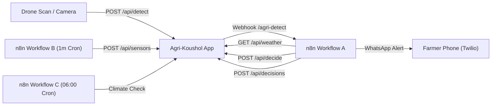

# Agri-Koushol n8n Automation Engine Setup Guide

This guide describes how to configure, run, and connect **n8n** (the workflow automation platform) with **Agri-Koushol** for autonomous farm management, sensor telemetry ingestion, and farmer WhatsApp alerts.

---

## 1. Overview of Included Workflows

The repository includes three ready-to-import workflows in `n8n-workflows/`:

| File | Trigger | Description | Core Actions |
|---|---|---|---|
| [`A-detection-pipeline.json`](file:///mnt/Workplace/Agri%20Koushol/Agri-Koushol%20Project/n8n-workflows/A-detection-pipeline.json) | Webhook (`POST /agri-detect`) | Autonomous response to drone leaf disease scans | Filters disease $\rightarrow$ Fetches weather $\rightarrow$ Calls `/api/decide` $\rightarrow$ Enforces AI safety rules $\rightarrow$ Saves Decision $\rightarrow$ Sends WhatsApp |
| [`B-sensor-feeder.json`](file:///mnt/Workplace/Agri%20Koushol/Agri-Koushol%20Project/n8n-workflows/B-sensor-feeder.json) | Schedule (Every 1 min) | Continuous telemetry simulator with diurnal cycle | Ingests soil moisture, temp, humidity, pH $\rightarrow$ Evaluates irrigation threshold $\rightarrow$ Triggers `/api/decide` if low moisture |
| [`C-daily-climate-check.json`](file:///mnt/Workplace/Agri%20Koushol/Agri-Koushol%20Project/n8n-workflows/C-daily-climate-check.json) | Schedule (Daily 06:00 AM) | Morning extreme weather & climate patrol | Scans all fields $\rightarrow$ Checks 48h rain/heat/frost $\rightarrow$ Pauses irrigation on rain $\rightarrow$ Sends farmer climate alert |



---

## 2. Running n8n with Docker

### Option A: Docker Compose (Recommended)

Create a `docker-compose.n8n.yml` file (or add to your existing compose file):

```yaml
version: "3.8"

services:
  n8n:
    image: docker.n8n.io/n8nio/n8n:latest
    container_name: agri-koushol-n8n
    restart: unless-stopped
    ports:
      - "5678:5678"
    environment:
      - N8N_HOST=0.0.0.0
      - N8N_PORT=5678
      - N8N_PROTOCOL=http
      - NODE_ENV=production
      - WEBHOOK_URL=http://localhost:5678/
      - GENERIC_TIMEZONE=Asia/Dhaka
      - TZ=Asia/Dhaka
      # Variables used by workflows:
      - APP_URL=http://host.docker.internal:3000
      - INGEST_API_KEY=dev-ingest-key
      - TWILIO_WHATSAPP_FROM=whatsapp:+14155238886
      - FARMER_WHATSAPP_TO=whatsapp:+8801700000000
    volumes:
      - n8n_data:/home/node/.n8n
    extra_hosts:
      # Allows the Docker container to communicate with the host Next.js app on Linux/macOS:
      - "host.docker.internal:host-gateway"

volumes:
  n8n_data:
```

Start n8n:
```bash
docker compose -f docker-compose.n8n.yml up -d
```

### Option B: Docker CLI One-Liner

```bash
docker run -d \
  --name agri-koushol-n8n \
  --restart unless-stopped \
  -p 5678:5678 \
  --add-host=host.docker.internal:host-gateway \
  -e GENERIC_TIMEZONE=Asia/Dhaka \
  -e TZ=Asia/Dhaka \
  -e APP_URL=http://host.docker.internal:3000 \
  -e INGEST_API_KEY=dev-ingest-key \
  -v n8n_data:/home/node/.n8n \
  docker.n8n.io/n8nio/n8n:latest
```

Open your browser at `http://localhost:5678` to complete initial account setup.

---

## 3. Exposing n8n to Receive Webhooks

When Next.js runs `runPipeline` with `USE_N8N=true`, it dispatches HTTP requests to `N8N_WEBHOOK_URL`. If n8n runs on another server or requires a public tunnel for remote drones/webhooks, expose port 5678:

### Method 1: ngrok

```bash
ngrok http 5678
```

Note the Forwarding URL (e.g. `https://abc-123.ngrok-free.app`).

### Method 2: Cloudflare Tunnel

```bash
cloudflared tunnel --url http://localhost:5678
```

Note the generated `trycloudflare.com` URL.

### Update Environment Variables

1. In n8n container environment, set:
   ```env
   WEBHOOK_URL=https://abc-123.ngrok-free.app/
   ```
   *(This ensures n8n generates production webhook URLs using the public tunnel address).*

2. In Agri-Koushol `.env`:
   ```env
   USE_N8N=true
   N8N_WEBHOOK_URL=https://abc-123.ngrok-free.app/webhook/agri-detect
   N8N_SHARED_SECRET=your-secure-webhook-secret-123
   ```

---

## 4. Configuring Credentials in n8n

Before importing the workflows, add the following two credentials in the n8n UI (**Settings** $\rightarrow$ **Credentials** $\rightarrow$ **Add Credential**):

### 1. Header Auth: `Agri-Koushol Shared Secret`
- **Credential Type**: *Header Auth*
- **Credential Name**: `Agri-Koushol Shared Secret (x-shared-secret)`
- **Header Name**: `x-shared-secret`
- **Header Value**: Must match `N8N_SHARED_SECRET` in your `.env` (e.g. `your-secure-webhook-secret-123`).

### 2. Twilio API: `Twilio account`
- **Credential Type**: *Twilio API*
- **Account SID**: Your Twilio Account SID (`AC...`)
- **Auth Token**: Your Twilio Auth Token

---

## 5. Importing the Workflows into n8n

For each workflow file in `n8n-workflows/`:
1. In the n8n UI, navigate to **Workflows**.
2. Click the **`...`** (three dots menu in top-right corner) and select **Import from File**.
3. Select `A-detection-pipeline.json`, `B-sensor-feeder.json`, or `C-daily-climate-check.json`.
4. Check that the credential dropdown on the **Webhook** and **Twilio** nodes points to your saved credentials.
5. In the top-right corner, toggle the switch from **Inactive** to **Active** and click **Save**.

---

## 6. Honest Notice: AI-Generated n8n JSON Caveats

> [!WARNING]
> n8n JSON exports are sensitive to internal version numbers, node type definitions, and environment-specific credential IDs. While these workflow files use standard n8n v1 schema specifications, importing AI-generated workflow JSON often requires 1–2 minutes of manual verification.

### The Three Most Likely Issues After Import

1. **Unconfigured Credential Attachments (`UNCONFIGURED_CREDENTIALS`)**:
   - **What happens**: Nodes like `Webhook` and `Send WhatsApp (Twilio)` show an orange or yellow warning badge.
   - **Why**: n8n identifies credentials by random internal UUIDs (`TWILIO_CREDENTIALS_ID`, `HEADER_AUTH_CREDENTIALS_ID`).
   - **Fix**: Open the node, click the **Credential** dropdown, pick your configured credential, and save.

2. **Webhook URL Path & Active Mode (`/webhook-test` vs `/webhook`)**:
   - **What happens**: Next.js logs `404 Not Found` when sending detections to `N8N_WEBHOOK_URL`.
   - **Why**: In n8n, when you click "Listen for test event", the endpoint is `/webhook-test/agri-detect`. However, production requests must go to `/webhook/agri-detect`.
   - **Fix**: You must toggle the workflow to **Active** in the top-right corner. Inactive workflows do not listen on `/webhook/...`.

3. **Node Version Drift & Expression Property Paths (`$json.body` vs `$json`)**:
   - **What happens**: The `Filter Disease` or `POST Decide` nodes evaluate fields as `undefined`.
   - **Why**: Depending on whether your n8n version runs Webhook Node v1 or v2 (and whether "Raw Body" is enabled), incoming payload fields may be accessible at `$json.body.label` or directly at `$json.label`.
   - **Fix**: The provided templates include fallback expressions (`$json.body ? $json.body.label : $json.label`). If an expression is unresolved in your specific n8n version, check the output tab of the previous node in the canvas and adjust the expression path.

---

## 7. Node-by-Node Manual Build Checklist

If you prefer building or verifying the workflows manually in the n8n canvas, follow these exact node sequences:

### Workflow A: Crop Guardian Detection Pipeline

1. **Webhook Node**:
   - **HTTP Method**: `POST`
   - **Path**: `agri-detect`
   - **Authentication**: `Header Auth` (Credential: `x-shared-secret`)
   - **Response Mode**: `When Last Node Finishes` (or `Using 'Respond to Webhook' Node`)
2. **IF Node (`Filter Disease`)**:
   - **Condition 1**: String `{{ ($json.body && $json.body.label) ? $json.body.label.toLowerCase() : ($json.label ? $json.label.toLowerCase() : '') }}` does not contain `healthy`.
   - **Condition 2**: Number `{{ Number(($json.body && $json.body.confidence !== undefined) ? $json.body.confidence : $json.confidence) }}` $\ge$ `0.6`.
   - **Combinator**: `AND`.
   - *False Branch*: Connect to **Respond to Webhook** node returning `{ "status": "no_action" }`.
3. **HTTP Request Node (`GET Field Details`)**:
   - **Method**: `GET`
   - **URL**: `={{ ($env.APP_URL || 'http://host.docker.internal:3000') }}/api/fields/{{ $('Webhook').item.json.body ? $('Webhook').item.json.body.fieldId : $('Webhook').item.json.fieldId }}`
   - **Header**: `x-api-key: dev-ingest-key`
4. **HTTP Request Node (`GET Weather`)**:
   - **Method**: `GET`
   - **URL**: `={{ ($env.APP_URL || 'http://host.docker.internal:3000') }}/api/weather/{{ $('Webhook').item.json.body ? $('Webhook').item.json.body.fieldId : $('Webhook').item.json.fieldId }}`
   - **Header**: `x-api-key: dev-ingest-key`
5. **HTTP Request Node (`POST Decide`)**:
   - **Method**: `POST`
   - **URL**: `={{ ($env.APP_URL || 'http://host.docker.internal:3000') }}/api/decide`
   - **Header**: `x-api-key: dev-ingest-key`
   - **Body**: JSON
     ```json
     {
       "fieldId": "={{ $('Webhook').item.json.body ? $('Webhook').item.json.body.fieldId : $('Webhook').item.json.fieldId }}",
       "detectionId": "={{ $('Webhook').item.json.body ? $('Webhook').item.json.body.detectionId : $('Webhook').item.json.detectionId }}"
     }
     ```
6. **HTTP Request Node (`POST Decisions`)**:
   - **Method**: `POST`
   - **URL**: `={{ ($env.APP_URL || 'http://host.docker.internal:3000') }}/api/decisions`
   - **Header**: `x-api-key: dev-ingest-key`
   - **Body**: JSON mapping decision action, reasoning, rescheduleTimeIso, severity, farmerMessage, farmerMessageBn, and `simulated: true`.
7. **Twilio Node (`Send WhatsApp`)**:
   - **Resource**: `SMS/MMS`
   - **Operation**: `Send`
   - **From**: `whatsapp:+14155238886`
   - **To**: `{{ $env.FARMER_WHATSAPP_TO }}`
   - **Message**: Combined English and Bangla farmer messages from step 5.
8. **Respond to Webhook Node**:
   - **Response Code**: `200`
   - **Body**: `{ "status": "success", "decision": ... }`

---

### Workflow B: Sensor Feeder & Soil Telemetry Simulator

1. **Schedule Trigger Node**:
   - **Interval**: Every `1` minute.
2. **Code Node (`Simulate Sensor Readings`)**:
   - Loops over the 4 fields (`Field A`, `Field B`, `Field C`, `Field D`).
   - Calculates 24h solar diurnal cycle:
     $$T = 27.5 + 5.5 \times \sin\left(\frac{(hour - 8)\pi}{12}\right) \pm \text{jitter}$$
   - Generates random-walk soil moisture (20% – 60%), diurnal relative humidity, and pH (6.1 – 6.9).
   - Returns 4 items.
3. **HTTP Request Node (`POST Sensor Telemetry`)**:
   - **Method**: `POST`
   - **URL**: `={{ $env.APP_URL }}/api/sensors`
   - **Header**: `x-api-key: dev-ingest-key`
   - **Body**: `{ fieldId, soilMoisture, temperature, humidity, ph, recordedAt }`
4. **IF Node (`Check Low Moisture`)**:
   - **Condition**: `{{ $json.soilMoisture }} < {{ $json.threshold }}`
5. **HTTP Request Node (`POST Decide Low Moisture`)**:
   - **Method**: `POST`
   - **URL**: `={{ $env.APP_URL }}/api/decide`
   - **Header**: `x-api-key: dev-ingest-key`
   - **Body**: `{ "fieldId": "...", "context": "Low moisture telemetry detected..." }`
6. **HTTP Request Node (`POST Decisions Irrigation`)**:
   - **Method**: `POST`
   - **URL**: `={{ $env.APP_URL }}/api/decisions`
   - **Header**: `x-api-key: dev-ingest-key`
   - **Body**: Records `IRRIGATE` decision with high severity.

---

### Workflow C: Daily Climate & Extreme Weather Check

1. **Schedule Trigger Node**:
   - **Trigger**: Cron `0 6 * * *` (06:00 AM daily).
2. **HTTP Request Node (`GET All Fields`)**:
   - **URL**: `={{ $env.APP_URL }}/api/fields`
   - **Header**: `x-api-key: dev-ingest-key`
3. **Code Node (`Split Fields into Items`)**:
   - Unpacks `{ fields: [...] }` to individual n8n items.
4. **HTTP Request Node (`GET Field Weather`)**:
   - **URL**: `={{ $env.APP_URL }}/api/weather/{{ $json.id }}`
   - **Header**: `x-api-key: dev-ingest-key`
5. **Code Node (`Analyze Climate Stress`)**:
   - Flags heavy rain ($>50\%$ probability, $>20\text{mm}$), heatwaves ($\ge 38^\circ\text{C}$), and frost ($\le 8^\circ\text{C}$).
6. **IF Node (`IF Climate Risk Detected`)**:
   - Condition: `{{ $json.hasRisk }} === true`
7. **HTTP Request Node (`POST Decisions`)**:
   - Creates climate mitigation decision (e.g. `PAUSE_IRRIGATION` on rain or `IRRIGATE` on heatwave).
8. **Twilio Node (`Send WhatsApp Climate Alert`)**:
   - Dispatches morning WhatsApp climate bulletin to farmer.

---

## 8. Verification & Testing

To test the entire n8n integration end to end:
1. Ensure the Next.js dev server is running on `http://localhost:3000`.
2. Ensure n8n is active with Workflow A active.
3. In Next.js, trigger a drone scan from the UI or run:
   ```bash
   curl -X POST http://localhost:3000/api/detect \
     -H "Content-Type: application/json" \
     -d '{ "fieldId": "cmvpap35100019ep849ii6yh8", "stagedImage": "late_blight" }'
   ```
4. Check the n8n **Executions** tab to see the live green execution flow passing through each node.
